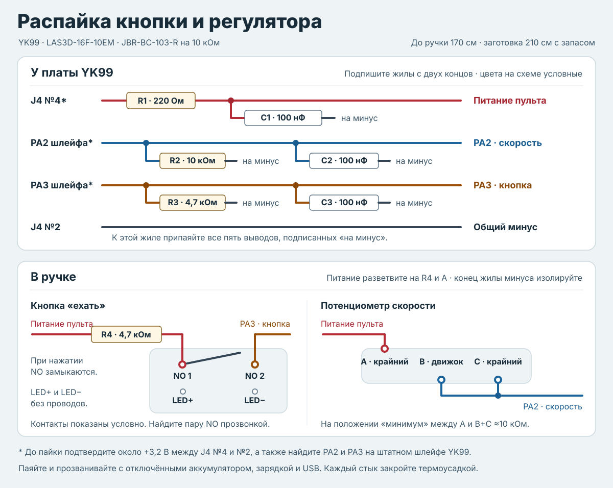

# Сборка и первая проверка

Комплект рассчитан на HAITEC HT-GW350 и раму гироскутера с платой YIYUN TECH YK99 на GD32F103RCT6. Маркировка платы, разводка разъёмов и выходные ключи могут различаться даже у похожих доноров. В проекте использована шина 10×2,125 дюйма с наружным диаметром около 254 мм.

## 1. Примерьте задний привод

1. Отключите аккумулятор и зарядное. Установите тележку на устойчивые опоры. Снимите штатные задние колёса. Оставьте мотор-колёса в родных прижимах на раме гироскутера.
2. Совместите ноги задней П-образной стойки тележки с площадками рамы донора над осями моторов. Проверьте одинаковую высоту слева и справа, свободное вращение и зазор до шины. Осмотрите литую раму и шарнир на трещины и люфт.
3. До сверления измерьте площадки с обеих сторон, толщину литья, положение рёбер, оси и проводов. В опубликованном варианте на каждую ногу приходятся две щёки из уголка 50×50×5 мм длиной 60 мм. Сверху и снизу литьё подпирают стальные пластины 60×120×5 мм. Эти размеры требуют примерки к своему донору.
4. Стальные детали размечайте и сверлите на верстаке. Под каждую ногу предусмотрены четыре сквозных болта М8 класса 8.8 с шайбами и самоконтрящимися гайками. Длина зависит от пакета деталей. Поперечный М10 через обе щёки ограничивает смещение ноги. Проверьте, что нагрузка передаётся через пятки и подкладки, а крепёж не упирается в ось, корпус мотора и провода.
5. Уложите и закрепите кабели с запасом хода у поворота дышла. Плата и силовые разъёмы должны быть закрыты. Проверьте вращение колёс рукой и отсутствие смещения рамы. Разметка краской на крепеже помогает заметить его поворот при последующем осмотре.

[Вид заднего моста](axle-1.svg) · [Узел крепления крупно](axle-2.svg)

## 2. Соберите пульт

На рукоятке стоят линейный регулятор 10 кОм и нормально разомкнутая кнопка без фиксации. Кнопка включает тягу, регулятор задаёт её уровень. Пульт заменяет малую плату YK96T на выбранном канале. Для сигнальных входов проверьте соответствие PA2 и PA3 на своей YK99. Силовые фазы и датчики моторов остаются в штатных разъёмах.

У платы четыре цепи. Питание логики 3,3 В проходит через R1 220 Ом. PA2 соединён с минусом через R2 10 кОм, PA3 через R3 4,7 кОм. C1, C2 и C3 по 100 нФ соединяют с минусом соответственно питание после R1, PA2 и PA3. В ручке R4 4,7 кОм включён последовательно с кнопкой. Движок регулятора соединён с одним из крайних выводов по схеме. Перед подключением платы прозвоните жгут и измерьте напряжение питания логики. Проверяйте назначение жил по выводам, цвета могут различаться.

## 3. Подготовьте питание

Установите съёмный аккумулятор 36 В в закреплённый отсек. Подберите защиту силовой цепи под батарею и проводку. Предусмотрите доступное независимое отключение питания. Для зарядки снятой батареи используйте совместимое с ней зарядное устройство и предназначенный для заряда разъём. Назначение XT60 и действие встроенной защиты при зарядке уточняют для конкретной батареи.

## 4. Запишите и проверьте прошивку

Для экземпляра проекта использованы ST-Link V2 и OpenOCD. На проверенной плате J4 от квадратной площадки имеет выводы 1 SWDIO, 2 GND и 3 SWCLK. Питание контроллера отдельное. Перед записью сверьте эти линии на своей плате и вывесьте колёса.

1. Сверьте скачанные файлы по SHA-256 и прочитайте [назначение вариантов прошивки](../firmware/README.md).
2. Из корня репозитория выполните `./firmware/flash.sh check` для связи и чтения состояния контроллера. При включённой защите чтения разблокировка стирает заводскую прошивку. Это отдельная необратимая операция. Если ревизия платы и выводы силового драйвера не подтверждены, остановитесь до записи.
3. Первое включение выполняйте на стенде с ограничением тока и возможностью сразу отключить питание. Для диагностики используйте `./firmware/flash.sh diag`. Сверьте направление обоих колёс, отсутствие самозапуска и реакцию на отпускание кнопки. Если мотор дёргается, греется или крутится в неверном направлении, отключите питание и проверьте фазы, датчики и выбранный вариант.
4. Для проверенной конфигурации рабочую сборку записывает `./firmware/flash.sh flash`. Повторите стендовую проверку уже с рабочей прошивкой. Проверьте отключение тяги при отпускании и при отключении жгута, а также независимое снятие питания.
5. Следующий этап — проба пустой тележки на ровном закрытом участке, затем ступенчатое увеличение груза с осмотром крепежа и проверкой нагрева. Отпускание кнопки снимает тягу. Перед испытаниями на уклоне требуется отдельное решение для торможения.
